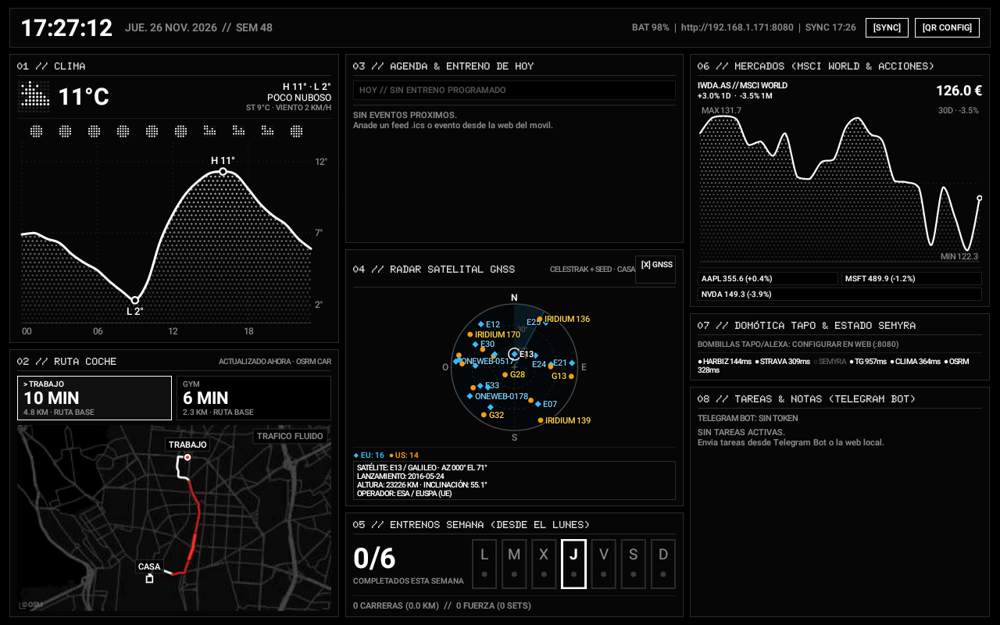
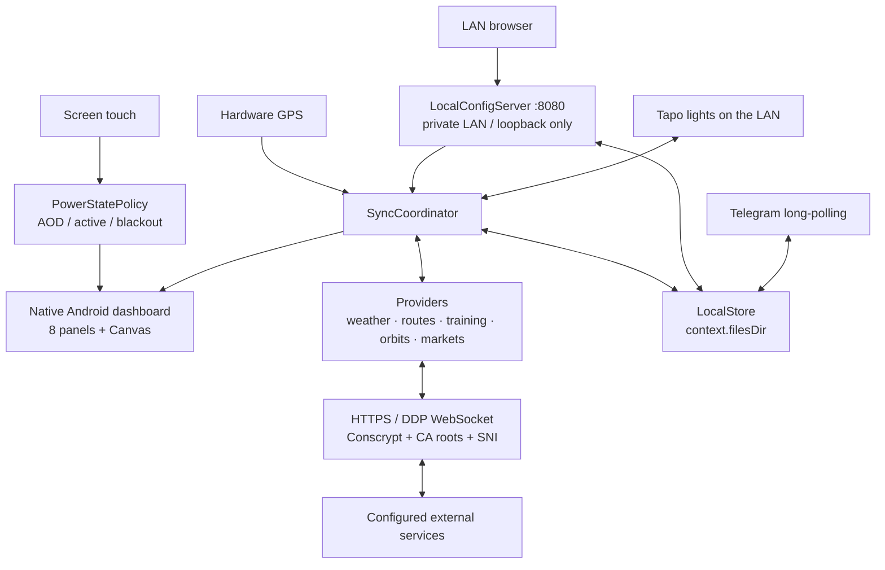
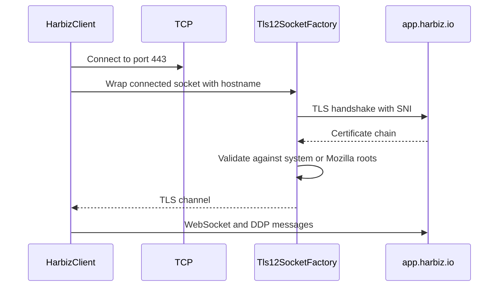

<div align="center">

# ASSISTANT // SM-T535

**A tablet from 2014. Eight panels. A second life.**

A wall or desk appliance with a brutalist dot-matrix interface,<br>
native Android rendering, and configuration over your local network.


[Concept](#a-second-life-for-useful-hardware) · [Dashboard](#eight-panels-at-a-glance) · [Architecture](#architecture) · [Installation](#build-and-install) · [License](#license-and-credits)

</div>



*Live capture of the eight-panel dashboard using a separate, empty demo installation. Routes use public Madrid landmarks: Puerta del Sol, Castellana, and Retiro. No personal accounts, calendar entries, training sessions, or Telegram tasks are included. The application's interface is currently in Spanish.*

## A second life for useful hardware

The **Samsung Galaxy Tab 4 10.1 SM-T535**, released in 2014, still has a useful display, Wi-Fi, and a real GPS receiver. ASSISTANT turns it into a persistent information surface for weather, commutes, schedules, workouts, satellites, markets, lights, and reminders.

The visual direction draws inspiration from **Nothing OS**: black backgrounds, thin borders, dots, and clear hierarchy. **Doto-Bold is reserved exclusively for card and section titles**. Clocks, numbers, buttons, axes, and body text use a traditional sans-serif font for readability.

The reference device runs **Android 5.0.2 Lollipop / SDK 21**. The interface uses Kotlin, native Android views, and Canvas graphics. The dashboard does not depend on a remotely hosted web page.

### A display that follows the day

| Default schedule | State | Behavior |
| --- | --- | --- |
| 09:00–18:00 | AOD | Reduced-brightness information display |
| 18:00–09:00 | Blackout | Black screen overnight |
| Screen touch | Active | Full dashboard, followed by an automatic return to the scheduled state |

Schedules, brightness, and activity timeouts are configurable. There is no camera permission or camera code: **wake is entirely touch-based**. Blackout describes the black visual state; it does not suspend Android or electrically switch off the LCD panel.

## Eight panels at a glance

| Panel | Information | Implementation |
| --- | --- | --- |
| **01 // 24-HOUR WEATHER** | Temperature, conditions, and the day's trend | Open-Meteo with a custom Canvas temperature curve |
| **02 // DRIVING ROUTES & LIVE TRAFFIC** | Travel time to work and the gym, route geometry, and congestion | TomTom Routing API, Google Directions, or OSRM; hardware GPS supplies the origin when a valid fix is available; a Web-Mercator vector minimap displays the route. With the default ten-minute interval, updates align with **:00, :10, :20, :30, :40, and :50** |
| **03 // TODAY'S SCHEDULE & WORKOUTS** | Training sessions and appointments | Harbiz through native DDP WebSocket, Strava OAuth2 with **Z1–Z5** heart-rate zones, iCal feeds, and manual events |
| **04 // GNSS & LEO SATELLITE RADAR (EU / US)** | Polar sky plot, **[X] GNSS** filter, and touch-selectable satellite details | CelesTrak TLEs, a local cache, and offline seed data; Keplerian propagation with secular **J₂** perturbations, alongside the tablet's GPS antenna observations |
| **05 // WEEKLY TRAINING** | Progress toward a weekly goal | Monday-to-Sunday activity view and training totals |
| **06 // MARKETS** | MSCI World reference instrument and stock watchlist | **IWDA.AS** reference quote, additional quotes, and sparklines; availability and delay depend on the provider |
| **07 // TAPO LIGHTING & SERVICE HEALTH** | Lighting controls and integration diagnostics | Local TP-Link Tapo control and API health/latency telemetry |
| **08 // REMINDERS & GUIDED TELEGRAM BOT** | Task capture and calendar exchange | Bidirectional long-polling bot: **/new**, **/record** with dates and urgency colors, **/agenda** to generate and send an **.ics file without an advance reminder**, and import by forwarding an .ics attachment to the chat |

### The sky on an old tablet

The catalog covers **Galileo, GPS, Starlink, ICEYE, Eutelsat OneWeb, Iridium NEXT, Planet, Spire, Copernicus Sentinel, MetOp, ISS, Hubble, and NOAA**. Selecting a satellite displays its launch date, altitude, inclination, and operator where metadata is available.

The radar combines actual GPS antenna observations with positions calculated from two-line orbital elements. Its **Kepler + $J_2$ propagator is a visualization approximation**, not an SGP4 implementation or a precision navigation tool. Cached elements and offline seed data keep the display available without a connection; accuracy depends on element age.

OSRM supplies baseline routes. Live traffic requires a provider that supplies congestion data. Integrations requiring credentials remain unconfigured until you add them through the portal.

## Architecture



### Local storage and optional integrations

Application configuration, credentials, tasks, and caches live in **context.filesDir**, inside Android's private application storage. **android:allowBackup="false"** disables automatic application backups. There is no project-operated backend storing your configuration.

Local storage does not imply entirely offline operation: weather, routing, Harbiz, Strava, markets, orbital catalogs, and Telegram contact their respective services when enabled. Information used by an integration is transmitted to that provider.

Repository defaults use public Madrid landmarks and empty credentials. Keep real configurations, credentials, personal exports, and private screenshots out of source control.

### LAN configuration portal // :8080

An embedded HTTP server lets you configure keys, locations, heart-rate zones, events, and tasks from a phone or computer browser.

1. Connect the tablet and browser to the same network.
2. Open the URL or QR code displayed on the tablet: **http://<TABLET-IP>:8080/**.
3. Configure the modules you want to use.

The server accepts **private LAN and loopback IP addresses**. The portal uses HTTP and is intended for a trusted network without Internet-facing port forwarding. Credentials stay on the device; repository defaults contain no account credentials.

## Modern TLS on Android 5.0.2

A tablet from 2014 can render the interface comfortably while failing to connect to current APIs because its system certificate store and TLS stack have aged.

ASSISTANT addresses this in three layers:

1. **Conscrypt 2.5.2** supplies a modern TLS provider on older Android versions. The socket factory enables **TLS 1.2 and TLS 1.3 when supported by the socket**.
2. A **Mozilla-derived bundle of 118 public root certificates** in **app/src/main/assets/certs/legacy-tls-roots.pem** supplements system trust on SDK 21/22. These certificates are public trust anchors, not private keys.
3. **Tls12SocketFactory** also implements the **zero-argument createSocket()** overload. Harbiz's DDP WebSocket first establishes TCP and then wraps the connected socket with TLS using the hostname, preserving **SNI** for **wss://app.harbiz.io/websocket**.



Certificate validation remains enabled; no trust manager accepts arbitrary chains. The bundled trust snapshot needs maintenance as provider trust requirements change.

## Build and install

### Requirements

- **JDK 17**.
- Android SDK with **platform 34** and build tools.
- PowerShell and Android Platform Tools (**adb**) for provisioning scripts.
- A tablet with USB debugging enabled and the computer authorized.

The project declares **minSdk 19**, **compileSdk 34**, and **targetSdk 34**. The reference device and compatibility work focus on **SDK 21**.

```powershell
git clone https://github.com/JaviBlzq/assistant.git
cd assistant
# Create local.properties with your Android SDK path.
# Windows example: sdk.dir=C:/Android
.\gradlew.bat test
.\gradlew.bat assembleDebug
```

The APK is generated at **app/build/outputs/apk/debug/app-debug.apk**. Signing keys and APKs are not included in the repository.

### Provisioning and kiosk mode

| Script | Purpose |
| --- | --- |
| [1-check-tablet.ps1](scripts/1-check-tablet.ps1) | Check ADB, USB authorization, and device properties |
| [2-debloat-samsung.ps1](scripts/2-debloat-samsung.ps1) | Remove or disable selected Samsung/Google packages for user 0; review the package list before running |
| [3-install-and-kiosk.ps1](scripts/3-install-and-kiosk.ps1) | Install the APK, configure the launcher, and attempt Device Owner / Lock Task setup |

Scripts expect ADB at **C:/Android/platform-tools/adb.exe**. Adjust this path for your installation.

```powershell
.\scripts\1-check-tablet.ps1
# Optional, after reviewing its package list:
.\scripts\2-debloat-samsung.ps1
.\scripts\3-install-and-kiosk.ps1
```

On **SDK < 23**, installation uses **adb install -r** without **-g**. On **SDK < 24**, the script avoids **/system/bin/cmd**. If Samsung Knox or an already provisioned device prevents Device Owner setup, the script reports the result; immersive launcher mode remains available. Lock Task depends on successful system owner configuration.

## Code map

```text
app/src/main/
├── java/com/javiblzq/assistant/
│   ├── data/          Configuration and local storage
│   ├── kiosk/         Startup, administration, and notifications
│   ├── net/           HTTP, Conscrypt, and TLS socket factory
│   ├── power/         Scheduled display policy
│   ├── providers/     Integrations, GPS, and orbital propagation
│   ├── server/        LAN HTTP configuration portal
│   └── ui/            Theme, panels, and Canvas rendering
└── assets/            Web portal, Doto, and root certificates
scripts/               ADB provisioning
docs/                  Screenshot, technical notes, and third-party licenses
```

## Contributing

Improvements for older hardware are welcome. Open an issue with the device model, Android version, reproduction steps, and logs with credentials removed. Explain changes in a pull request and run **gradlew.bat test** before submitting.

Preserve the appliance constraints: touch wake, no camera, private local storage, SDK 21 compatibility, and Doto exclusively for titles. Do not commit personal configurations, tokens, keystores, or screenshots containing private data.

## License and credits

Original code is released under the **[MIT License](LICENSE)**. Doto retains its **SIL Open Font License**, and third-party resources retain their respective terms; see [THIRD_PARTY_NOTICES.md](docs/THIRD_PARTY_NOTICES.md).

Thanks to the Kotlin, Android, Conscrypt, Open-Meteo, OpenStreetMap, OSRM, and CelesTrak communities, and the projects and services behind the optional integrations. This is an independent project with no affiliation to Samsung, Nothing, or the named service providers.
